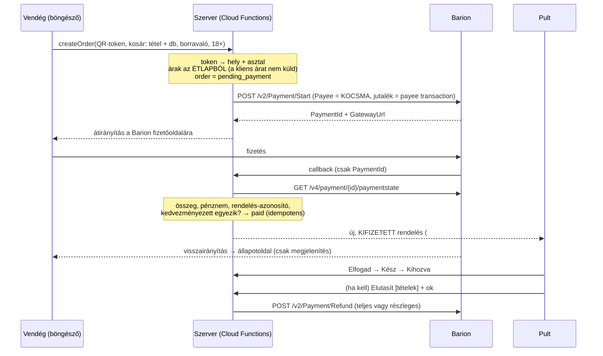

# Scan & Sip – QR-kódos asztali rendelés és fizetés (ötlet és koncepció)

*Állapot: ötlet + működő demó-váz (2026-11-27). Különálló projekt; a Happy Hour Detector (HHD) stílusát és alapelveit viszi tovább, de annak kódját és tesztjeit nem érinti.*

> A projekt kódja és demója a közös repóban van: `tto658/kozos` → `scan-and-sip/` mappa. Ez a fájl az ötlet másolata a HHD ötlettárában.

## 1. Összefoglaló

A vendég beolvassa az asztalon (pulton, teraszon) lévő QR-kódot, a telefonja böngészőjében megnyílik a hely étlapja – app és regisztráció nélkül. Összeállítja a rendelést, Barionnal kifizeti, a pénz **közvetlenül a kocsma Barion-fiókjába** érkezik, a pultnál pedig megjelenik a **kifizetett** rendelés egy rövid átvételi kóddal. Ha valami elfogyott, a pult elutasítja (egészben vagy tételenként), és a rendszer **automatikusan visszatéríti** az árát.

Kinek jó?

- **Vendég:** nem kell sorban állni a pultnál vagy a pincérre várni; látja az árakat; egy érintéssel fizet; ha valami nincs, automatikusan visszakapja a pénzét.
- **Pultos:** egy képernyőn látja a kifizetett rendeléseket asztal + kód szerint; nincs „ki fizetett már?”, nincs elszökő vendég.
- **Tulajdonos:** gyorsabb kiszolgálás, több rendelés csúcsidőben, átlátható napi elszámolás.

## 2. A londoni minta – mit veszünk át és mit nem

Londonban a QR-os „scan, order, pay” mára alapszolgáltatás a kocsmákban (pl. Storekit, QikServe, Dines, Orderpay, Wi5 megoldásai).

Átvesszük:

- **App és fiók nélkül** – a QR a böngészőben nyit; a pubban ez a legfontosabb, különben marad a sor a pultnál.
- **Az asztal automatikusan kiválasztódik** a QR-kódból.
- **A pult csak kifizetett rendelést kap** – így nincs nyitott számla és „elfelejtett” fizetés.
- **Szüneteltetés csúcsidőben** – a pult egy kapcsolóval leállíthatja a QR-rendelést.
- **Borravaló** a felületen, opcionálisan.

Nem vesszük át:

- **Rejtett vendégdíj.** Volt rá példa, hogy egy londoni étterem plusz díjat számolt fel az appos fizetésért, ami komoly felháborodást váltott ki. Nálunk a vendég pontosan az étlapárat (+ opcionális borravalót) fizeti; a platform díját a hely viseli, átlátható módon.

## 3. Felhasználói út

**Vendég**

1. QR beolvasása → hely neve, asztal, étlap (kategóriák, árak, „elfogyott” jelölés).
2. Tételek, darabszám, megjegyzés („jéggel”, „citrommal”).
3. Kosár: borravaló (nincs / 5 / 10 / 15 %), **18+ megerősítés**, tájékoztató a visszatérítésről.
4. „Fizetés Barionnal” → Barion fizetőoldal (bankkártya, Apple Pay / Google Pay, Barion-tárca – a Barion kínálata szerint).
5. Visszairányítás → **állapotoldal**: átvételi kód (pl. `D6P`), „Fizetés ellenőrzése… → Kifizetve → Készül → Kész → Kihozva”.
6. Ha a pult elutasít valamit: „Visszatérítve: 980 Ft”.

**Pult**

1. Élő tábla: **Új / Készül / Kész – vinni** oszlopok; kártyán asztal, kód, tételek, megjegyzés.
2. Elfogad → Kész → Kihozva.
3. Elutasít: teljes rendelés vagy csak a bejelölt tételek + ok (Elfogyott / Záróra / …) → automatikus visszatérítés.
4. „Figyelmet igényel” sáv: eltérő fizetési adat, elakadt visszatérítés (újrapróbálás gombbal).
5. Étlap: tétel elfogyott / van; rendelés szüneteltetése; napi összesítő (rendelésszám, bevétel visszatérítés után, jutalék, visszatérítések).
6. QR-kódok nyomtatása asztalonként; kód cseréje (a régi azonnal érvénytelen).

**Admin (platform)**

Hely felvétele, a kocsma Barion-fiókjának (kedvezményezett) ellenőrzése a cégadatokkal, díjmodell beállítása, pultos-jogosultságok kiosztása.

## 4. A pénz útja – azonnali fizetés + visszatérítés

**Döntés (2026-11-27):** *azonnali* (Immediate) Barion-fizetés, elutasításkor *visszatérítéssel* – így a vendégnek a leggördülékenyebb (nincs „zárolt, de még nem terhelt” állapot). A foglalásos (Reservation) változat tartalékként dokumentálva marad (lásd 4.4).

### 4.1 Közvetlen kifizetés a kocsmának

- A Barion `Payment/Start` kérésben a tranzakció **kedvezményezettje (Payee) a kocsma saját Barion-fiókja** – a vendég pénze oda érkezik, a platform nem „tartja” a pénzt.
- A platform jutaléka a kocsma tranzakciójához kapcsolt **payee transaction** (a Barion piactér-mintája szerint: a jóváírás után a jutalékrész a piactérhez kerül). Havidíjas modellnél ilyen tranzakció nincs.
- Feltétel: a kocsmának **regisztrált, aktív Barion-fiók** kell (a Barion dokumentációja szerint a payee transaction címzettje csak ilyen lehet), és a platformnak Barion-szerződés (bolt + POSKey, a facilitált / piactéri működés jóváhagyása).
- A kocsma a Barion-egyenlegéből a saját bankszámlájára utal (kivét) – a pontos menetét, időzítését és díját a Barionnal kell egyeztetni.

### 4.2 Biztonságos, szerveroldali igazolás

- **A kliens soha nem igazol fizetést.** A Barion visszairányítása után a vendég oldala csak megjelenít; a rendelés állapota nem változik tőle.
- A **callback** (Barion → szerver) csak a `PaymentId`-t adja; a szerver ezzel lekérdezi a **Payment/State**-et, és csak akkor teszi `paid`-re a rendelést, ha **minden** egyezik: fizetés- és rendelés-azonosító, pénznem (HUF), végösszeg, a kocsma tranzakciójának kedvezményezettje és összege. Eltérésnél `attention` (kézi ellenőrzés), a pult nem kapja meg kihozatalra.
- **Idempotencia:** ugyanaz a callback többször is jöhet; a második már nem változtat (állapotgép + tranzakció).
- **Késő callback:** ha a vendég előbb ér vissza, az állapotoldal lekérdezése is a szerveren át kérdez rá a Barionra.
- **Takarítás:** ütemezett feladat 10 percenként lezárja a fizetési ablakon (15 perc) túl függő rendeléseket.
- **Titkok:** a POSKey Secret Managerben; a domain-kód és a kliens sosem látja.

### 4.3 Visszatérítés

- **Teljes elutasítás:** `rejected → refund_pending → refunded` (a teljes összeg, borravalóval).
- **Részleges elutasítás** (pl. elfogyott a fröccs): a rendelés megy tovább; a kiesett tételek ára + a borravaló arányos része jár vissza; a ráeső platform-jutalék a kocsmának jóváíródik (elszámolás).
- Soha nem térítünk vissza többet, mint ami befizetett és még nem visszatérített.
- Ha a Barion visszautasítja: `refund_failed`, a pultnál „Visszatérítés újra” gomb + ütemezett újrapróbálás; a vendég „szólj a pultnál” üzenetet lát.
- Egyeztetendő a Barionnal: a payee transaction-nel elvitt jutalék visszatérítéskor hogyan kezelődik, és ki viseli a visszatérítés költségét.

### 4.4 Tartalék: foglalásos fizetés

A Barion támogatja a foglalást (Reservation): a vendég fizetésekor az összeg zárolódik, és csak a `FinishReservation` híváskor terhelődik. Előnye, hogy elfogyott italnál nincs visszatérítés; hátránya a „zárolt, de még nincs terhelve” állapot, ami a vendégnek zavaró lehet. Most nem ezt választottuk; a domain-modell (állapotgép, Barion-leképezés) a későbbi átállást lehetővé teszi.

## 5. Díjmodell – három változat (a döntés később születik)

A kódban mindhárom paraméterként szerepel (`FeeModel`), és helyenként beállítható. **A vendégre egyik változatban sem terhelünk külön díjat.** A Barion saját tranzakciós díja a szerződéstől függ – ezt a modell nem tartalmazza, és kitalált számot sem írunk be.

| Változat | Mit fizet a kocsma | Előny | Hátrány |
|---|---|---|---|
| **A) Havidíj** | fix havi összeg helyenként, rendelésenként 0 | kiszámítható, „no commission” üzenet (Londonban is népszerű) | kis forgalmú helynek drága lehet; a platform bevétele nem nő a forgalommal |
| **B) Tranzakciós jutalék** | a rendelés tételösszegének X%-a (opcionális min./max. tétellel), borravalóból nem | belépési küszöb nélkül, a hely csak a használatért fizet | nagy forgalomnál drága; „jutalékos platform” megítélés |
| **C) Vegyes** | kisebb havidíj + kisebb jutalék | kiegyensúlyozott | bonyolultabb elmagyarázni |

Nyitott kérdések: az árszintek; az első hónapok kedvezménye (pilot); a jutalék alapja (tételösszeg borravaló nélkül – javasolt); a Barion-díj ki viseli; számlázás a kocsma felé (havi összesítő).

## 6. Adatmodell (Firestore)

| Gyűjtemény | Fő mezők | Ki írja |
|---|---|---|
| `venues/{id}` | név, `demo`, `hhdPlaceId?`, `barionPayee`, `payeeVerified`, `fee` (díjmodell), `status`, `orderingPaused` | admin; a szüneteltetést a hely személyzete |
| `venues/{id}/tables/{tid}` | címke, `tokenHash` (SHA-256), `active` | admin / szerver (token-csere) |
| `venues/{id}/menu/{iid}` | név, kategória, `priceHuf` (egész), kiszerelés, `available` | a hely személyzete – **valódi helyhez kitalált ár soha** |
| `staff/{uid}` | `venueIds[]` | admin |
| `orders/{oid}` | hely, asztal, tétel-pillanatkép, részösszeg, borravaló, végösszeg, díj-bontás, állapot, átvételi kód, `guestKeyHash`, `ageConfirmed`, `payment`, `refunds[]`, idővonal | **csak a szerver** |
| `paymentEvents/{id}` | PaymentId, rendelés, időpont, eredmény (audit) | **csak a szerver** |

**Állapotgép:** `pending_payment → paid → accepted → ready → served`; mellékágak: `payment_failed`, `expired`, `attention`, `rejected → refund_pending → refunded / refund_failed`. Fizetéshez kötött átmenetet csak a szerver, pultos átmenetet csak a hely személyzete hajthat végre; a vendég egyiket sem.

## 7. Képernyők (a demóban mind megvan)

- **Vendég:** étlap kategória-chipekkel → kosár (megjegyzés, borravaló, 18+) → Barion (a demóban szimulátor) → állapotoldal nagy átvételi kóddal és LED-folyamatjelzővel.
- **Pult:** élő tábla, elutasítás tételenként, „Figyelmet igényel” sáv, elfogyott-kapcsolók, szüneteltetés, napi összesítő.
- **QR-nyomtatás:** asztalonként egy kártya, nyomtatóbarát.
- **Stílus:** a HHD „Carbon Mint” palettája (karbon alap, menta LED-kiemelés, vékony fénycsíkok), mobil-első, jó kontraszt, `prefers-reduced-motion` tisztelete.

## 8. Biztonság és visszaélések

| Kockázat | Védelem |
|---|---|
| Hamis „sikeres fizetés” a kliensről | Csak a szerver állíthat `paid`-et, a Barion Payment/State alapján; Firestore-szabály: rendelést kliens nem írhat |
| Ármanipuláció | A kliens csak tételazonosítót és darabszámot küld; az árat a szerver az étlapból számolja |
| Eltérő összeg / kedvezményezett a fizetésben | Teljes egyezés-ellenőrzés → `attention`, kézi ellenőrzés |
| Dupla / késő callback | Idempotens állapotgép, tranzakciós írás, állapotoldali újralekérdezés, ütemezett takarítás |
| Lemásolt / lefotózott QR, „távoli tréfa-rendelés” | Csak előre fizetett rendelés jut a pultra (nincs kár); token-csere; szüneteltetés; később: nyitvatartás-ellenőrzés |
| Más vendég rendelésének lekérdezése | Titkos vendégkulcs (csak a lenyomata tárolt) |
| Pultos más hely rendeléseihez nyúl | `staff/{uid}.venueIds` ellenőrzés szerveren és szabályban |
| Túlzott visszatérítés | Felső korlát: befizetett − már visszatérített |

## 9. Jog és megfelelés – egyeztetendő (könyvelő, jogász, Barion)

- **Nyugta / számla:** a vendéglátóhelynek a QR-rendelésről is bizonylatot kell adnia; tisztázandó, hogy ez a hely pénztárgépéből / számlázójából vagy integráción át történik.
- **NTAK-adatszolgáltatás** (vendéglátás): a hely meglévő rendszere (RMS) hogyan kapja meg a QR-rendeléseket.
- **Alkohol 18+:** a vendég megerősíti; a pultos kihozatalkor ellenőrizheti; kiskorúnak nem szolgálunk ki.
- **GDPR:** a vendégtől nem kérünk nevet / e-mailt; a fizetési adatokat a Barion kezeli; adatkezelési tájékoztató és ÁSZF kell.
- **Barion-szerződés:** facilitált / piactéri működés, KYC a kocsmák felé, díjak.

## 10. Kapcsolat a Happy Hour Detectorral

- Közös helyazonosító (`hhdPlaceId`): később a HHD adatlapján „Rendelj QR-ral” jelzés azoknál a helyeknél, ahol a Scan & Sip be van vezetve.
- Az étlapot a kocsmáros viszi fel – a HHD szabálya itt is érvényes: **valódi helyhez soha nem rendelünk kitalált árat, készletet, rendelést vagy pénzügyi / szponzorációs adatot.**
- A HHD „Szponzorált” ital-kiemelése később megjelenhet a Scan & Sip étlapján is, egyértelmű jelöléssel – az organikus sorrend itt sem megvehető.

## 11. Ütemterv

1. **Demó (kész):** kattintható vendég- és pult-felület, Barion-szimulátor, 44 automata teszt.
2. **Barion tesztkörnyezet:** Firebase-projekt, Cloud Functions élesítése, `api.test.barion.com`, teszt-POSKey Secret Managerben; a mezőnevek ellenőrzése (Payment/State tranzakció-mezők, Refund `AmountToRefund`), e2e próbafizetések.
3. **Pilot egy partnerkocsmával:** saját Barion-fiók, valódi étlap a kocsmárostól, 3–5 asztal, nyomtatott QR-ok; visszajelzések.
4. **Bővítés:** nyitvatartás-ellenőrzés, hangjelzés / értesítés a pultnál, napi elszámolás-export, nyugta- / NTAK-integráció, HHD-összekötés.

## 12. Nyitott kérdések

- Díjmodell és árszintek (5. pont).
- Barion: facilitált működés feltételei, díjak, jutalék kezelése visszatérítéskor, kivét a kocsma bankszámlájára.
- Nyugta / NTAK megoldása.
- Melyik Firebase-projekt (külön, vagy a közös `happyhour-a52e9`)?
- Szükséges-e pultos-bejelentkezés helyett eszközhöz kötött „pult-mód” (tablet a pulton)?
